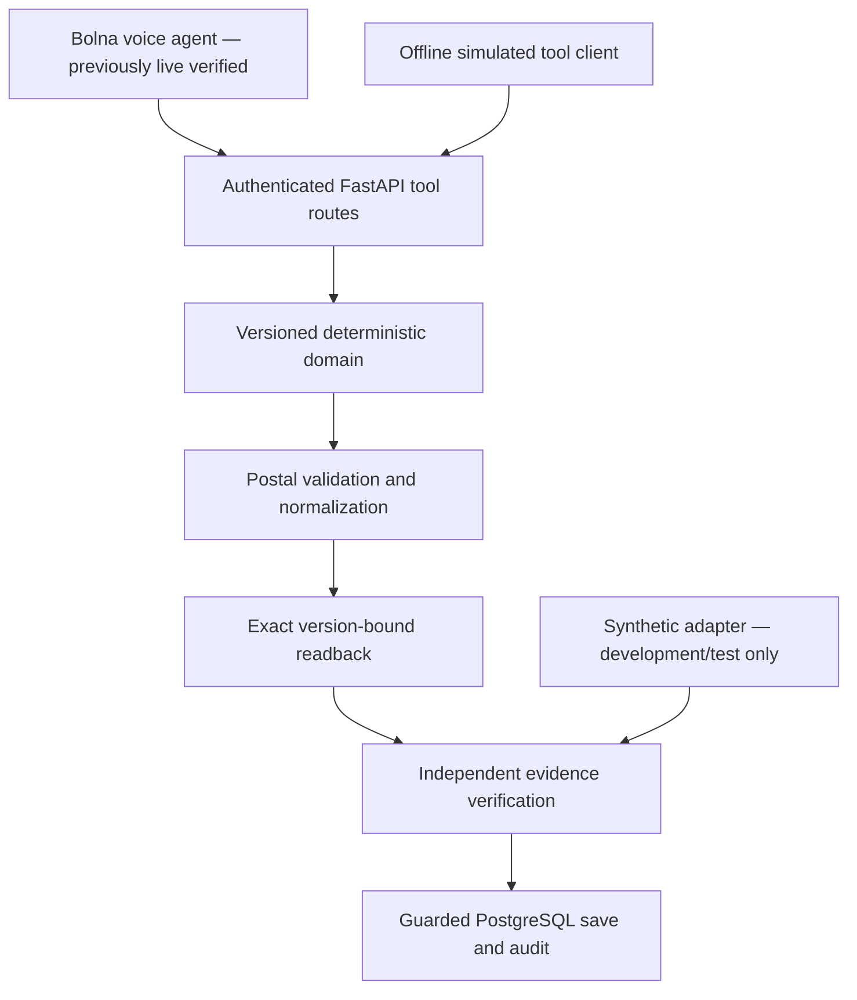

# Assignment demonstration guide

**ASSIGNMENT IMPLEMENTATION: COMPLETE**  
**PRODUCTION READINESS: NOT READY**

This submission combines previously recorded live Bolna integration evidence with a deterministic **OFFLINE_BOLNA_SIMULATION**. Synthetic evidence is never presented as a customer phone call or production consent.

## Run the demonstration

In this prepared workspace, from the project folder in PowerShell:

```powershell
.venv\Scripts\python.exe scripts/demo_end_to_end.py --verbose
```

No Bolna credentials, credits, tunnel, API server process, or external voice provider is required. PostgreSQL must be running. The runner invokes actual FastAPI routes through an in-process ASGI client. PostgreSQL connections are real; no repository, validator, transaction, state machine or readback is mocked.

If PostgreSQL is stopped:

```powershell
docker compose --env-file local-data/development.env up -d postgres
.venv\Scripts\python.exe scripts/run_local.py migrate upgrade head
$env:APP_ENV='development'
.venv\Scripts\python.exe scripts/demo_end_to_end.py --verbose
```

On a fresh checkout, first install Python 3.11+, Docker Desktop and dependencies (`python -m venv .venv`, then `.venv\Scripts\python.exe -m pip install -e '.[dev]'`). Run `scripts/init_local_config.py` once only if `local-data/development.env` does not exist. Follow the database commands above. The generated credentials stay private; the runner does not read the Bolna `.env`.

The normalized demo postal artifact is local, not bundled in source. If missing, import the supplied CSV once, without modifying it:

```powershell
$env:APP_ENV='development'
$env:ALLOW_UNVERIFIED_POSTAL_DATA='true'
.venv\Scripts\python.exe scripts/import_demo_postal_data.py --input C:\Users\palak\Downloads\pincodes.csv --output local-data/postal/demo-pincodes.json --reject-malformed-rows
```

The explicit exclusion applies to the three malformed records previously reviewed: 39,736 read, 39,733 accepted, 3 excluded. The artifact retains original-source checksum/provenance and remains **UNVERIFIED_OR_STALE**. Import refuses to overwrite an existing artifact. An evaluator on another machine must receive the CSV/artifact separately and use its actual path. `--postal-data PATH` selects a local artifact (or a clean, strictly valid CSV); there is no fabricated postal fallback.

Run all verification:

```powershell
.venv\Scripts\python.exe scripts/run_local.py test -q --tb=short
.venv\Scripts\python.exe -m unittest discover -s tests -v
.venv\Scripts\python.exe scripts/demo_end_to_end.py
```

The test wrapper runs `python -m pytest` with privately loaded PostgreSQL credentials. Plain `python -m pytest -q` also works when `TEST_DATABASE_URL` is configured; otherwise PostgreSQL tests are skipped. The recorded submission run used real PostgreSQL with no skipped tests.

## 1. Problem

A voice agent must collect an address progressively, handle corrections and avoid saving stale or unconfirmed information. An LLM's conversational memory and spoken assurance are insufficient evidence for a database commit.

## 2. Architecture



The offline runner uses the same application factory, middleware, tool schemas, repositories and transactions as the backend. Only external utterances, playback completion and customer-confirmation evidence are simulated.

## 3. Backend ownership

The backend owns versions, canonical fields, validation results and save eligibility. The LLM may propose customer-supplied changes but cannot set `validated`, `confirmed` or `trusted` flags. Every write checks the expected version. Corrections immediately revoke prior eligibility.

## 4. Bolna integration

Seven hosted functions route through authenticated tool requests. Session credentials are fixed in tool configuration; privileged server-side execution binding ties each session to its call. Typed variable mapping preserves JSON strings safely. The offline client sends those same action/version/changes_json schemas; it does not contact Bolna or simulate provider logs.

## 5. PostgreSQL design

Sessions retain the aggregate state, while address versions, validation attempts, readback attempts, confirmation events, final addresses and audit events preserve history. Transactions and database constraints protect concurrency and idempotency. The runner uses read-only SQL to verify persisted rows; all address mutations go through HTTP routes. Each run creates a new uniquely labelled demo session and retains its audit history without editing live sessions.

## 6. Versioning and normalization

Progressive input creates v1 (premise), v2 (area), v3 (city/state), v4 (PIN). The simulated spoken PIN is transported as `1 1 0 0 0 1`; the real normalizer produces `110001`, preserving raw input and creating v5. This deliberately demonstrates normalization rather than assigning a canonical version manually. The integration test also covers an already canonical PIN with no extra normalization version.

## 7. Postal validation

The real validator checks the supplied demo directory, required fields, PIN and state consistency. The intended example is B-302, Connaught Place, New Delhi, Delhi, 110001. Validation is VALID under the demo policy, but city and area retain warnings that they are not postally verified. This does not prove deliverability or official provenance. Production rejects the unverified-data opt-in.

## 8. Correction handling

The simulated correction, “Actually the flat is B-320,” creates v6 and clears validated_version, confirmed_version and current readback. The runner asserts those values before revalidation. It then creates a fresh validation attempt and readback. No previous customer acceptance is carried forward.

## 9. Readback binding

The backend generates and prints the exact text. Each attempt binds session, execution, current version, validation attempt, attempt ID and SHA-256 digest. The corrected readback has a different ID, version and digest. The runner checks these values against the persisted state. This is **TEXT/OFFLINE readback**, not proof of audible playback.

## 10. Confirmation security

The demo demonstrates HTTP 409 VERSION_CONFLICT for old-version confirmation, EVIDENCE_BINDING_MISMATCH for stale readback/completion and stale confirmation references, and ADDRESS_NOT_CONFIRMED for premature save.

Only then does the local synthetic adapter issue correctly bound completion and subsequent positive-confirmation evidence. Issuance is an in-process method, with no remotely selectable flag or endpoint. The adapter refuses production construction, and application startup rejects its injection into production even if it was constructed for test/development elsewhere. Production's default RejectAllEvidenceVerifier is unchanged. Separate privileged evidence credentials remain required at the normal evidence endpoint.

## 11. Live evidence already obtained

**LIVE VERIFIED:** real Bolna tool selection and HTTP dispatch, authentication, execution/session ownership, PostgreSQL candidate mutations and version progression. The corrected mapping run reached v5; the earlier demo postal call reached v4. The final controlled PIN call reached v3 and captured 201016 rather than intended 110001. Failed validations remain failed in their historical reports.

See [typed transport live report](typed-live-report.md), [demo postal live report](demo-postal-report.md), and [controlled PIN report](pin-controlled-report.md). The controlled PIN mismatch was already present in transcription; caller speech versus recognition error remains unadjudicated without audio review.

## 12. Offline deterministic result

**OFFLINE / SYNTHETIC VERIFIED:** successful real postal validation using unverified demo data, normalization, readback, correction/revalidation, stale-evidence rejection, synthetic confirmation, PostgreSQL commit and duplicate-save idempotency.

The final current_version = validated_version = confirmed_version = **6**. The second save returns the same address ID. Session-scoped persisted counts are:

| Table | Rows |
|---|---:|
| address_sessions | 1 |
| address_versions | 6 |
| validation_attempts | 2 |
| readback_attempts | 2 |
| confirmation_events | 2 |
| addresses | 1 |
| audit_events | 15 |

The runner prints actual versions and audit events, and writes sanitized evidence to `local-data/offline-demo/evidence.json`. A submission snapshot is [offline E2E evidence](testing/offline-e2e-evidence.json). It contains only synthetic demonstration addresses, identifiers, request statuses, reasons, counts and bindings; no credentials.

## 13. Limits and truthful scope

**NOT CLAIMED:** official production postal provenance, production-grade independent consent, successful final live save, physically played offline readback, or fully adjudicated production conversation quality. `conversation_outcome` remains null; the offline `test_result` is PASS.

Production is not ready until verified postal data and an independently trustworthy playback/confirmation adapter are available. Bolna credits are exhausted, so no further calls were attempted. Credit availability is an external testing constraint, not an application defect. The assignment implementation and deterministic software demonstration are complete within this stated scope.
